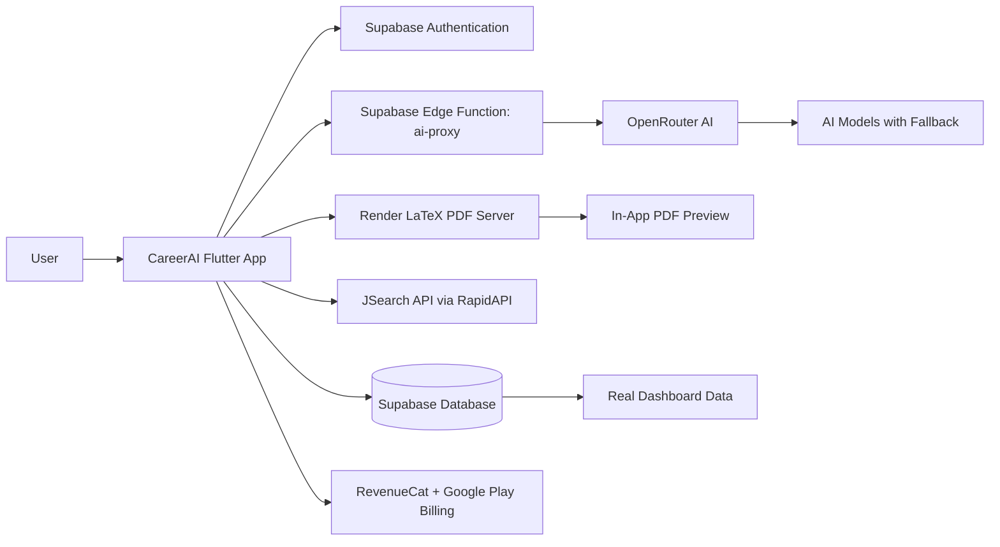

# CareerAI

> AI-powered career growth companion for Indian students, freshers, and job seekers.

CareerAI is a Flutter-based mobile application that helps users build stronger resumes, prepare for interviews, discover relevant jobs, receive personalised career guidance, and follow a clear career roadmap.

Built for Indian youth aged 18–28, CareerAI combines AI-powered career tools with real user data, job discovery, interview practice, resume generation, and premium career support in one mobile experience.

## Why CareerAI?

CareerAI brings essential career-growth tools into a single application:

- Analyse resumes with ATS-style AI feedback
- Build professional resumes using LaTeX templates
- Practice AI-powered mock interviews
- Get personalised career guidance from an AI Coach
- Search, save, and track real job applications
- Generate career roadmaps based on current status and goals
- Track career progress from a real-data dashboard
- Unlock advanced tools through a premium system

## Key Features

### Resume Analyzer

CareerAI provides detailed AI-powered resume analysis inspired by ATS and JobScan-style feedback.

Features include:

- ATS score
- Overall resume score
- Job-description match score
- Section-wise scoring for:
  - Contact information
  - Professional summary
  - Experience
  - Skills
  - Education
  - Formatting
- Keywords found in the resume
- Missing keywords based on the job description
- ATS issues and formatting problems
- Strengths and weaknesses
- Before-and-after improvement suggestions
- Premium usage limits for free users

### Resume Builder

Create polished, downloadable resumes directly inside the app.

Features include:

- Four LaTeX-based resume templates
- Seven-step resume creation flow:
  1. Personal information
  2. Professional summary
  3. Experience
  4. Education
  5. Skills
  6. Projects
  7. Achievements
- PDF generation through a Render-hosted LaTeX server
- In-app PDF preview
- Download PDF to the device Downloads folder
- Share generated resumes
- Premium limits for free downloads

### AI Career Coach

CareerAI includes a personalised, India-focused AI career coach.

Features include:

- Conversational AI career guidance
- Personalised responses based on user profile information
- AI-generated welcome message
- Quick prompt chips for common career topics
- Career chat history saved in Supabase
- Continue previous conversations
- Daily rotating career tips
- Premium coaching topics, including:
  - Deep career roadmap
  - Resume review
  - Mock negotiation guidance
- Free daily message limits with premium access controls

### AI Interview Practice

Prepare for interviews with AI-generated questions and personalised feedback.

Supported interview types:

- Role-based interviews
- Resume-based interviews
- Topic-based interviews

Features include:

- Configurable role, difficulty, question type, and question count
- Guided interview session flow
- Progress bar and previous/next question navigation
- AI-generated interview questions
- AI feedback after completion
- Overall interview score
- Per-question feedback
- Ideal answers
- Strengths and weaknesses
- Personalised improvement tips
- Interview history saved in Supabase
- Premium daily usage limits

### Job Hub

CareerAI connects users with real job opportunities through JSearch API via RapidAPI.

Features include:

- Real job listings
- Job search and filters
- Detailed job view
- Save and unsave jobs
- Apply through the original job link
- Applied jobs tracking
- Real applications data stored in Supabase
- Saved jobs management

### Career Roadmap

CareerAI generates structured AI-powered career roadmaps for premium users.

Features include:

- Input current career status and target goal
- AI-generated roadmap summary
- Numbered career phases
- Skill recommendations
- Actionable steps
- Career timeline
- Save roadmaps to Supabase
- Access previously saved roadmaps
- Premium feature access control

### Personalised Home Dashboard

The home screen uses real user data instead of dummy statistics.

Features include:

- Personalised greeting using the user profile
- Latest resume score card
- Career progress indicators for:
  - Resume completion
  - Interview practice
  - Applications submitted
  - Profile completion
- AI suggestions based on missing profile or career data
- Recent activity feed
- Premium upgrade banner
- Quick access to:
  - Resume Analyzer
  - Resume Builder
  - Interview Practice
  - AI Career Coach
  - Job Hub
- Pull-to-refresh support

### Premium System

CareerAI includes a complete premium-access and usage-tracking system.

Free usage limits:

| Feature | Free Limit |
|---|---|
| Resume Analyzer | 3 analyses |
| Resume Builder | 3 PDF downloads |
| AI Career Coach | 5 messages per day |
| Interview Practice | 2 sessions per day |

Premium features include:

- Advanced career-roadmap access
- Premium AI coaching topics
- Additional resume analysis access
- Additional resume-download access
- Additional interview-practice access
- Smart feature usage tracking
- Feature-specific premium lock screens

Subscription plans:

| Plan | Price |
|---|---|
| Monthly Premium | ₹149/month |
| Yearly Premium | ₹999/year |

Premium access is managed with RevenueCat and Google Play billing.

### Authentication and Onboarding

CareerAI provides secure account access and personalised onboarding.

Features include:

- Email and password signup
- Email and password login
- Native Google OAuth sign-in
- Supabase authentication
- Auth gate for logged-in and logged-out users
- Role-selection onboarding
- Referral-code system
- Referral celebration flow
- Profile-based personalisation

### Notifications

CareerAI includes in-app activity notifications for important user actions, such as:

- Resume analysis completed
- Interview session completed
- New career activity
- Application updates
- Career-progress milestones

## Architecture



## Technology Stack

| Layer | Technology |
|---|---|
| Mobile framework | Flutter 3.41.4 |
| Programming language | Dart |
| State management | Flutter Riverpod |
| Backend | Supabase |
| Authentication | Supabase Auth |
| Database | Supabase PostgreSQL |
| Serverless backend | Supabase Edge Functions |
| AI gateway | OpenRouter AI |
| Job API | JSearch API via RapidAPI |
| Resume PDF service | Render-hosted LaTeX server |
| PDF preview | `flutter_pdfview` |
| PDF generation support | `syncfusion_flutter_pdf` |
| Google sign-in | `google_sign_in` |
| File selection | `file_picker` |
| File sharing | `share_plus` |
| Premium subscriptions | RevenueCat |
| App icon generation | `flutter_launcher_icons` |

## AI System

CareerAI uses a Supabase Edge Function named `ai-proxy` to securely connect the app with OpenRouter AI.

The AI system supports fallback between multiple free models, including:

- `deepseek/deepseek-chat:free`
- `meta-llama/llama-4-scout:free`
- `openrouter/free`
- `google/gemma-3-12b-it:free`

Supported AI tasks:

| Task | Description |
|---|---|
| `coach_chat` | Personalised AI career guidance |
| `coach_welcome` | AI-generated personalised welcome message |
| `analyze_resume` | ATS-style resume analysis |
| `interview_questions` | AI-generated interview questions |
| `interview_feedback` | AI interview feedback and ideal answers |
| `career_roadmap` | Personalised career roadmap generation |

## Application Structure

```text
lib/
├── core/
│   ├── config/
│   ├── errors/
│   ├── premium/
│   ├── theme/
│   ├── widgets/
│   └── utilities/
│
├── features/
│   ├── auth/
│   ├── coach/
│   ├── home/
│   ├── jobs/
│   ├── menu/
│   ├── notifications/
│   ├── onboarding/
│   ├── premium/
│   ├── profile/
│   ├── roadmap/
│   ├── splash/
│   └── tools/
│       ├── interview/
│       ├── resume_analyzer/
│       └── resume_builder/
│
└── services/
    ├── ai_service.dart
    ├── local_storage.dart
    └── supabase_service.dart
```

## Database Design

CareerAI uses Supabase tables for authenticated users, career data, AI history, resumes, jobs, and premium usage.

| Table | Purpose |
|---|---|
| `profiles` | Stores user profile details, role, career preferences, avatar, and premium status |
| `feature_usage` | Tracks free-tier feature usage |
| `resumes` | Stores resume-analysis metadata and scores |
| `applications` | Stores jobs applied to by the user |
| `saved_jobs` | Stores bookmarked jobs |
| `coach_chats` | Stores AI Coach conversation history |
| `interviews` | Stores interview sessions, scores, answers, feedback, and tips |
| `roadmaps` | Stores AI-generated career roadmaps |
| `referrals` | Stores referral records |
| `referral_uses` | Tracks referral-code usage |

## Getting Started

### Prerequisites

Install the following before running the project:

- Flutter SDK 3.41.4 or compatible version
- Dart SDK, included with Flutter
- Android Studio or Visual Studio Code
- Android Emulator or physical Android device
- Supabase project
- OpenRouter API key
- RapidAPI key for JSearch
- Render-hosted LaTeX PDF server
- RevenueCat project and Google Play billing configuration

Verify your Flutter installation:

```bash
flutter doctor
```

### Clone the Repository

```bash
git clone https://github.com/sonukumawat-sde/careerai.git
cd careerai
```

### Install Dependencies

```bash
flutter pub get
```

### Configure Backend Services

Before running the application, configure:

1. **Supabase**
   - Enable email/password authentication
   - Enable Google OAuth
   - Create the required database tables
   - Deploy the `ai-proxy` Edge Function

2. **OpenRouter**
   - Store `OPENROUTER_API_KEY` in Supabase Edge Function secrets

3. **JSearch API**
   - Configure RapidAPI access for live job listings

4. **LaTeX PDF Server**
   - Configure the Render-hosted PDF-generation service

5. **RevenueCat**
   - Configure monthly and yearly subscription products
   - Connect RevenueCat with Google Play billing

### Run the Application

```bash
flutter run
```

## Useful Development Commands

```bash
flutter pub get
flutter analyze
flutter test
flutter run
flutter build apk
flutter build appbundle
```

| Command | Purpose |
|---|---|
| `flutter pub get` | Download project dependencies |
| `flutter analyze` | Run static analysis |
| `flutter test` | Run application tests |
| `flutter run` | Run the app on a device or emulator |
| `flutter build apk` | Build Android APK |
| `flutter build appbundle` | Build Android App Bundle for Play Store |

## Security Practices

- Keep API keys and secrets outside the Flutter client.
- Store OpenRouter credentials in Supabase Edge Function secrets.
- Do not commit `.env` files, keys, tokens, or service-account credentials.
- Use Supabase authentication for protected user data.
- Keep premium-access validation server-backed where applicable.
- Validate payment and subscription status through RevenueCat.

## Contributing

1. Create a feature branch from `main`.
2. Keep commits clear and focused.
3. Run `flutter analyze` before creating a pull request.
4. Add tests for important business logic and new features.
5. Keep secrets out of source control.
6. Update this README when adding or changing major features.

## License

No license file is currently included in this repository.

Add an appropriate license before defining reuse, distribution, or contribution terms.
